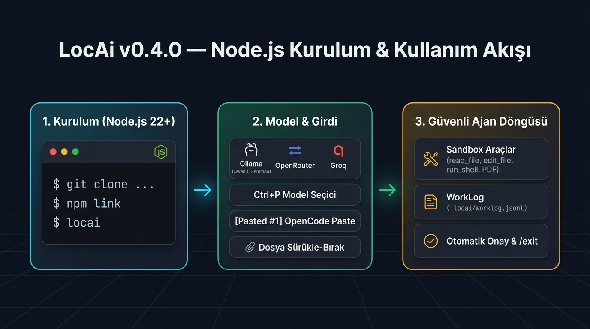

# 📦 LocAi Kurulum Kılavuzu / Installation Guide (Node.js v0.4.0-js)

**LocAi**, sıfır harici npm bağımlılığına sahip saf **Node.js (ESM)** tabanlı yerel AI kodlama ajanıdır. Windows, macOS ve Linux üzerinde çalışır.



---

## 📋 Gereksinimler / Prerequisites

1. **Node.js 22+** (`node -v` ile doğrulayın) — [nodejs.org](https://nodejs.org/)
2. **Ollama** (yerel modeller için) — [ollama.ai](https://ollama.ai/)
   - İsteğe bağlı bulut sağlayıcılar: **OpenRouter**, **Groq**, **NVIDIA NIM**, **NineRouter**
3. *(İsteğe bağlı)* **poppler-utils** (`pdftotext`): `read_file` aracının `.pdf` dosyalarını doğrudan okuyabilmesi için:
   - Ubuntu/Debian: `sudo apt install poppler-utils`
   - macOS: `brew install poppler`
   - Windows: `winget install oschwartz10612.Poppler`

---

## 🚀 Kurulum / Installation

### 0. Node.js 22+ Kurulumu (Sisteminizde Yoksa)

Önce terminalde `node -v` çalıştırarak Node.js sürümünüzü kontrol edin. Kurulu değilse veya sürüm `v22` altındaysa işletim sisteminize göre kurun:

- **🐧 Linux (Ubuntu / Debian) — `nvm` ile (Önerilen):**
  ```bash
  curl -o- https://raw.githubusercontent.com/nvm-sh/nvm/v0.40.1/install.sh | bash
  source ~/.bashrc   # zsh kullanıyorsanız: source ~/.zshrc
  nvm install 22
  node -v            # v22.x.x görünmeli
  ```
- **🍎 macOS — Homebrew ile:**
  ```bash
  brew install node@22
  node -v
  ```
- **🪟 Windows — `winget` veya resmi yükleyici ile:**
  ```powershell
  winget install OpenJS.NodeJS.LTS
  ```
  *(Alternatif olarak [nodejs.org](https://nodejs.org/) üzerinden **Node.js 22+ LTS** kurulum dosyasını indirip kurabilirsiniz.)*

### 1. Repoyu Klonla ve Global Olarak Bağla (`npm link`)

```bash
git clone https://github.com/ilhanakd-max/Local_Ajan.git
cd Local_Ajan
npm link
```

Bu işlemden sonra terminalin herhangi bir yerinden şu komutların üçü de çalışır:
- `locai`
- `lokal-ajan`
- `localajan`

Alternatif olarak `npm install -g .` ile de global kurulum yapabilirsiniz.

### 2. Yerel Model İndir (Ollama)

```bash
# Önerilen hafif yerel modeller
ollama pull qwen3:1.7b
ollama pull hf.co/unsloth/Qwen3-4B-Instruct-2507-GGUF:Q4_K_M

# Ollama sunucusunun çalıştığından emin olun
ollama serve
```

### 3. Başlat / Run

```bash
# Proje klasörüne gidin ve başlatın
cd /proje/klasorunuz
locai
```

---

## ⚙️ CLI Parametreleri / Options

| Seçenek | Açıklama |
|---|---|
| `-m, --model <ad>` | Kullanılacak model (örn. `qwen3:1.7b`, `openrouter/free`, `groq/...`) |
| `-w, --worker <ad>` | Orkestratör modu için alt-işçi (worker) modeli |
| `--host <url>` | Ollama adresi (varsayılan: `http://localhost:11434`) |
| `--workdir <dizin>` | Çalışma dizini (varsayılan: mevcut dizin) |
| `-p, --prompt <metin>` | Tek seferlik görev çalıştır ve çık |
| `-y, --auto-confirm` | Dosya yazma/düzenleme ve shell komutlarını otomatik onayla (**varsayılan: açık**) |
| `--no-auto-confirm` | Her yazma/shell işlemi öncesi kullanıcı onayı iste |
| `--ponytail` | Minimalist kodlama modu (sıfır aşırı mühendislik) |
| `--session <ad>` | Kayıtlı oturumu yükle |
| `-v, --version` | Sürüm bilgisini göster (`LocAi (Node.js) v0.4.0-js`) |
| `-h, --help` | Yardım mesajını göster |

---

## 💬 Etkileşimli REPL Komutları & Kısayollar

- **`Ctrl+P`**: Etkileşimli ok tuşlu model seçiciyi açar
- **OpenCode Tarzı Yapıştırma**: Çok satırlı veya uzun metin yapıştırıldığında otomatik olarak `[Pasted #1 ~N lines]` pill'ine dönüşür; `Enter` ile gönderildiğinde tam metne açılır
- **Dosya Sürükle-Bırak**: Terminale bir dosya yolu bıraktığınızda (örn. `'/yol/Plan.md'`) dosya içeriği otomatik olarak mesaja eklenir
- `/help`: Tüm komutları listeler
- `/model [ad]`: Model seçiciyi açar veya model değiştirir
- `/log [clear]`: Küçük modeller için tutulan çalışma günlüğünü (`.locai/worklog.jsonl`) gösterir veya temizler
- `/ponytail`: Minimalist kodlama modunu açar/kapatır
- `/save <ad>` / `/load <ad>` / `/sessions`: Oturumları kaydeder, yükler veya listeler
- `/clear` / `/history`: Sohbet geçmişini temizler veya özetler
- `/exit` (veya `/quit`): Uygulamayı temiz şekilde kapatır

---

## 🔧 Testleri Çalıştırma / Running Tests

```bash
npm test
```
