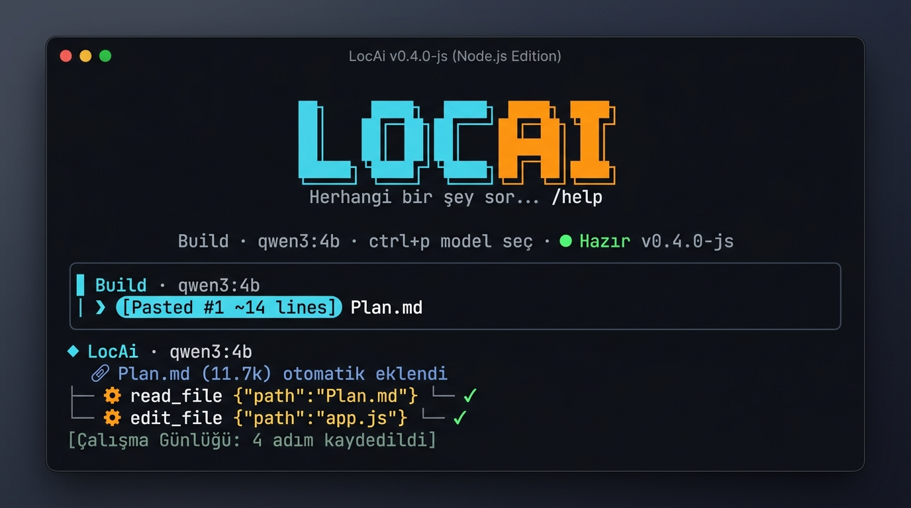
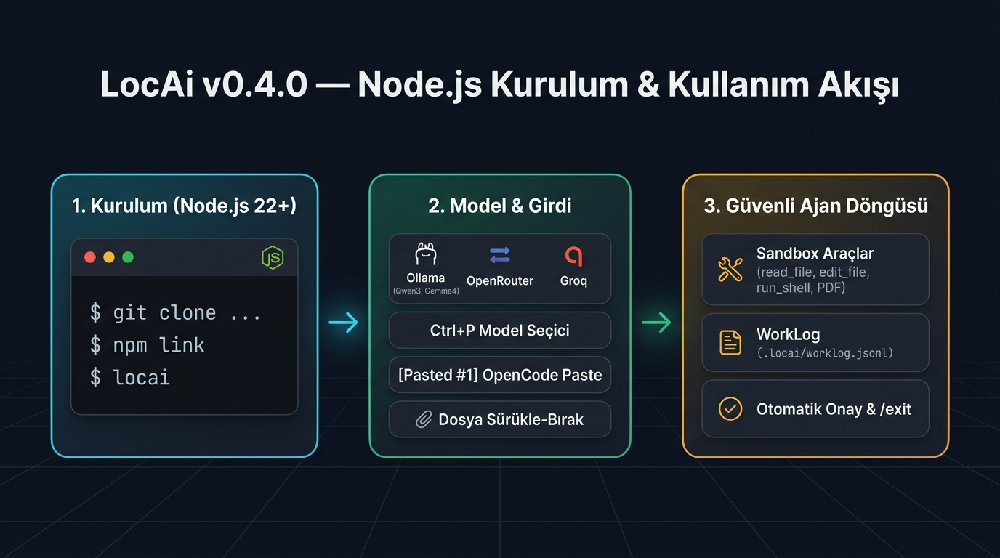

<div align="center">


# LocAi
**Small Models. Real Agents.**  
*Zero-Dependency Node.js Local AI Coding Agent for Ollama & Cloud LLMs*

[](https://nodejs.org/)
[](LICENSE)
[](https://ollama.ai)
[](package.json)
[](CONTRIBUTING.md)

🌐 **Official Website:** [locai-cli.netlify.app](https://locai-cli.netlify.app/)



**LocAi v0.4.0-js**, harici npm bağımlılığı olmadan saf **Node.js 22+ (ESM)** ile çalışan, özellikle **0.6B–4B** arası küçük yerel modellerin gerçek projelerde güvenle kod yazabilmesi, dosya okuyabilmesi ve komut çalıştırabilmesi için tasarlanmış terminal tabanlı bir yapay zeka kodlama ajanıdır.

📦 **Version:** `0.4.0-js` • 📝 **Changelog:** [CHANGES_qwen3.md](CHANGES_qwen3.md) • 📦 **Kurulum:** [INSTALL.md](INSTALL.md)

[🇹🇷 Türkçe Kılavuz](#türkçe-kılavuz) • [🇬🇧 English Guide](#english-guide) • [📦 Kurulum / Install](INSTALL.md) • [🤝 Katkı / Contribute](CONTRIBUTING.md)

</div>

---

<h2 id="türkçe-kılavuz">🇹🇷 Türkçe Kılavuz</h2>

### ✨ Neden LocAi (Node.js v0.4.0-js)?

- **Sıfır Bağımlılık, Anında Kurulum**: Saf Node.js 22+ ESM mimarisi (`npm link` ile saniyeler içinde `locai` komutu hazır).
- **OpenCode Tarzı Yapıştırma (Bracketed Paste)**: Çok satırlı veya uzun metinleri terminale yapıştırdığınızda satır sonlarında erken gönderim yapmaz; `[Pasted #1 ~N lines]` pill'i olarak gösterir ve gönderimde tam metne açar.
- **Sürükle-Bırak Dosya Ekleme**: Terminale bıraktığınız dosya yollarını (`'/yol/Plan.md'`) çalışma dizini sandbox'ı içinde otomatik okuyup bağlama ekler (`.pdf` dosyaları `pdftotext` ile metne çevrilir).
- **Kalıcı Çalışma Günlüğü (`WorkLog`)**: Küçük modellerin uzun görevlerde veya bağlam kırpılmasında ne yaptığını unutmaması için `.locai/worklog.jsonl` dosyasına her adımı kaydeder ve gerektiğinde bağlama enjekte eder (`/log` ile görüntülenebilir).
- **Küçük Model Onarım & Kurtarma Katmanı**: Bozuk `<tool_call>` etiketlerini, hatalı JSON'ları, eşanlamlı araç adlarını (`repair.js`), kayıp `</think>` bloklarını ve tekrar döngülerini (`RepetitionLoopGuard`) otomatik düzeltir.
- **Otomatik Onay & Akıcı REPL**: Araç çağrıları varsayılan olarak otomatik onaylanır (`--no-auto-confirm` ile kapatılabilir), görev tamamlandığında yeni komut bekler ve `/exit` ile temiz şekilde kapanır.
- **Hibrit Sağlayıcı Desteği (`Ctrl+P`)**: Yerel **Ollama** modelleri (Qwen3, Gemma 4, LFM3, DeepSeek) ile **OpenRouter**, **Groq**, **NVIDIA NIM** ve **NineRouter** arasında anında geçiş.



### 🚀 Hızlı Kurulum ve Kullanım

```bash
# 1. Repoyu klonla ve global CLI olarak bağla
git clone https://github.com/ilhanakd-max/Local_Ajan.git
cd Local_Ajan
npm link

# 2. Ollama'yı başlat ve bir model indir
ollama pull qwen3:1.7b

# 3. Proje klasöründe başlat
cd /proje/klasorun
locai
```

### ⌨️ Temel Komutlar ve Kısayollar

| Komut / Kısayol | Açıklama |
|---|---|
| `Ctrl+P` | Ok tuşlarıyla interaktif model seçici |
| `/model [ad]` | Model listesi veya doğrudan model değiştirme |
| `/log` / `/log clear` | Küçük model çalışma günlüğünü görüntüle / temizle |
| `/ponytail` | Minimalist kodlama modunu aç/kapat |
| `/save <ad>` / `/load <ad>` | Oturum kaydet / yükle (`/sessions` ile listele) |
| `/clear` / `/history` | Sohbet geçmişini temizle / durumu gör |
| `/help` | Yardım menüsü |
| `/exit` | Uygulamadan çık |

### 🛠️ Yerleşik Araçlar (Sandbox Korumalı)

- **Dosya Sistemi**: `read_file` (PDF destekli), `write_file`, `edit_file` (eşleşmeyen `old_str` için en yakın satır ipuçlu), `list_dir`, `glob`, `grep`
- **Semantik Arama & Git**: `semantic_code_search`, `git_status`, `git_diff`
- **Kabuk & Doğrulama**: `run_shell` (`keepTail` hata koruma + tehlikeli komut engelleme), `report_finding`

---

<h2 id="english-guide">🇬🇧 English Guide</h2>

### 🎯 What is LocAi v0.4.0-js?
LocAi is a **zero-dependency Node.js (ESM)** local AI coding agent engineered specifically to make small local LLMs (`0.6B–4B`) reliable on real codebases.

### ⚡ Quick Start

```bash
git clone https://github.com/ilhanakd-max/Local_Ajan.git
cd Local_Ajan
npm link          # installs global `locai`, `lokal-ajan`, `localajan`
locai --version   # LocAi (Node.js) v0.4.0-js
locai
```

### 🧩 Key Capabilities
- **OpenCode-Style Bracketed Paste**: Multi-line pastes collapse into `[Pasted #N ~M lines]` pills and expand cleanly on submit.
- **Auto-Attached Local Files**: Drag-and-drop file paths into the terminal (`'/path/to/Plan.md'`) to auto-attach contents (including `.pdf` via `pdftotext`).
- **Persistent `WorkLog` (`.locai/worklog.jsonl`)**: Automatically injected when context pruning occurs or multi-step tasks grow, so small models never lose track of completed steps.
- **Tool-Call Repair & Guards**: Handles malformed XML/JSON tool tags, tool/arg aliases (`src/agent/repair.js`), closest-line hints on failed `edit_file`, `keepTail` shell output truncation, and `RepetitionLoopGuard`.
- **Tests**: Run `npm test` (28 unit tests via Node's built-in `node --test` runner).

---

<div align="center">
  <sub>MIT License • Built with pure Node.js ESM • <a href="INSTALL.md">Full Installation Guide</a></sub>
</div>
